# Implementation Plan: Dietary Guidance RAG Chatbot

**Document Reference**: `doc/implemenation-phase.md`  
**Related Documents**: [`doc/architecture.md`](file:///C:/Users/HP/workspace/AI_AI_AI/ToDo/rag-nutrison/doc/architecture.md), [`doc/problemStatement.md`](file:///C:/Users/HP/workspace/AI_AI_AI/ToDo/rag-nutrison/doc/problemStatement.md)  
**Corpus Source**: `data/blocks.jsonl` (1,001 canonical structural blocks across 7 authoritative publications)  
**Target Environment**: Python 3.11+ / FastAPI / ChromaDB / Groq LLM API (openai/gpt-oss-120b / qwen/qwen3.6-27b) / Next.js 15 (App Router, React 19, TypeScript, Tailwind CSS)

---

## 1. Executive Summary & Implementation Strategy

This implementation plan defines the complete engineering roadmap for building the **Dietary Guidance RAG Chatbot**. The plan translates the requirements from [`doc/problemStatement.md`](file:///C:/Users/HP/workspace/AI_AI_AI/ToDo/rag-nutrison/doc/problemStatement.md) and technical architecture from [`doc/architecture.md`](file:///C:/Users/HP/workspace/AI_AI_AI/ToDo/rag-nutrison/doc/architecture.md) into concrete, sequential, and verifiable milestones.

### 1.1 Core Strategic Constraints
1. **Zero External Data Fetching**: System ingestion operates solely on the local `data/blocks.jsonl` file. No live web scraping, external network requests, or raw PDF parsing are executed during ingestion.
2. **Guaranteed Structural Integrity**: Tabular blocks (`type="table"`) must remain intact without destructive row-level or cell-level token slicing.
3. **Deterministic Guardrails Before Retrieval**: Queries violating safety rules (medical advice, calorie prescriptions, target weights) must be intercepted programmatically prior to vector retrieval or LLM inference.
4. **Calibrated Similarity Cutoff ($\tau_{relevance} = 0.68$)**: Queries lacking sufficient semantic matches trigger an explicit information gap refusal (Refusal 1) that lists all queried documents.
5. **Isolated Attribution & No Agency Blending**: Multi-document responses must segregate evidence under distinct per-authority headings with verifiable citations (`[Document Title | Publisher, Year | Source URL]`).
6. **Real-Time Streaming & Full Provenance UX**: Token streaming via Server-Sent Events (SSE) directly into an accessible Next.js 15 client featuring interactive citation pills and a slide-over provenance drawer.

---

## 2. Master Phase Dependency Graph & Traceability Matrix

### 2.1 Execution Dependency Graph (Mermaid)

```mermaid
flowchart TD
    subgraph Foundation["Phase 0: Environment & Contracts"]
        P0_Env["0.1 Python & Node Setup"]
        P0_Config["0.2 Corpus Registry & Settings"]
        P0_Schemas["0.3 Pydantic Data Contracts"]
        P0_Env --> P0_Config --> P0_Schemas
    end

    subgraph DataPipeline["Phase 1: Ingestion & Assembly"]
        P1_Reader["1.1 Block Stream Reader"]
        P1_Chunker["1.2 Hierarchy & Table Preserving Chunker"]
        P1_Tests["1.3 Chunking Unit Tests"]
        P0_Schemas --> P1_Reader --> P1_Chunker --> P1_Tests
    end

    subgraph IndexRetrieval["Phase 2: Indexing & Retrieval"]
        P2_Vector["2.1 ChromaDB Store Setup"]
        P2_Index["2.2 Offline Ingestion CLI"]
        P2_Retriever["2.3 Dual-Mode Retriever & Thresholding"]
        P2_Tests["2.4 Retrieval Verification Tests"]
        P1_Tests --> P2_Vector --> P2_Index --> P2_Retriever --> P2_Tests
    end

    subgraph Guardrails["Phase 3: Safety Guardrails"]
        P3_Regex["3.1 Deterministic Safety Filter"]
        P3_Handlers["3.2 Refusal 1 & 2 Formatters"]
        P3_Tests["3.3 Guardrail Unit Tests"]
        P0_Schemas --> P3_Regex --> P3_Handlers --> P3_Tests
    end

    subgraph Generation["Phase 4: Synthesis & Provenance"]
        P4_Prompts["4.1 Grounded Prompt Templates"]
        P4_Synthesizer["4.2 Isolated Multi-Doc Synthesizer"]
        P4_Citations["4.3 Citation Formatter & Auditor"]
        P4_Tests["4.4 Synthesis Grounding Tests"]
        P2_Tests --> P4_Prompts
        P3_Tests --> P4_Prompts
        P4_Prompts --> P4_Synthesizer --> P4_Citations --> P4_Tests
    end

    subgraph BackendAPI["Phase 5: FastAPI Gateway & SSE"]
        P5_FastAPI["5.1 FastAPI Application Core"]
        P5_SSE["5.2 Asynchronous SSE Streaming (/v1/chat/stream)"]
        P5_REST["5.3 REST Endpoints (/v1/chat, /v1/documents)"]
        P5_Tests["5.4 API Integration & Streaming Tests"]
        P4_Tests --> P5_FastAPI --> P5_SSE --> P5_REST --> P5_Tests
    end

    subgraph FrontendFoundation["Phase 6: Next.js 15 / React Frontend Foundation & Diagnostic Explorer"]
        P6_Init["6.1 Next.js 15 App Router + React 19 + Tailwind Setup"]
        P6_BFF["6.2 BFF Route Handlers (/api/chat, /api/documents)"]
        P6_Explorer["6.3 Native React Diagnostic & Corpus Explorer (/explorer)"]
        P6_State["6.4 useChatbot FSM & SSE Event Parser Engine"]
        P5_Tests --> P6_Init --> P6_BFF --> P6_Explorer --> P6_State
    end

    subgraph FrontendChat["Phase 7: Next.js 15 Conversational UI & Verifiable Provenance UX"]
        P7_ChatUI["7.1 ChatContainer, MessageList & ChatInputArea"]
        P7_Scope["7.2 ScopeSelector (Global vs. Scoped Pills)"]
        P7_Provenance["7.3 GroundedAnswerView & Interactive Citation Badges"]
        P7_Drawer["7.4 Accessible Slide-Over CitationDrawer (Radix UI)"]
        P7_MultiSource["7.5 MultiSourceView (Segmented / Split Comparison)"]
        P7_Refusals["7.6 RefusalCard (Amber Corpus Gap & Crimson Safety)"]
        P7_A11y["7.7 WCAG 2.1 AA Keyboard & Screen Reader Accessibility"]
        P6_State --> P7_ChatUI --> P7_Scope --> P7_Provenance --> P7_Drawer --> P7_MultiSource --> P7_Refusals --> P7_A11y
    end

    subgraph Verification["Phase 8: End-to-End Acceptance & Delivery"]
        P8_Acceptance["8.1 Acceptance Criteria Test Suite (6 Scenarios)"]
        P8_Perf["8.2 Latency, TTFT & Memory Benchmark"]
        P8_Docs["8.3 README & Trade-off Documentation"]
        P7_A11y --> P8_Acceptance --> P8_Perf --> P8_Docs
        P6_Explorer -.-> P8_Acceptance
    end

    subgraph Deployment["Phase 9: Production Cloud Deployment & CI/CD (Vercel & Railway)"]
        P9_Docker["9.1 Backend Containerization & Railway Config"]
        P9_Vercel["9.2 Frontend Vercel Config & Streaming BFF"]
        P9_Actions["9.3 GitHub Actions Unified CI/CD Pipeline"]
        P9_Deploy["9.4 Live Cloud Deployment (Railway + Vercel)"]
        P9_Smoke["9.5 Production Smoke Testing & Verification"]
        P8_Docs --> P9_Docker --> P9_Vercel --> P9_Actions --> P9_Deploy --> P9_Smoke
    end
```



### 2.2 Traceability Matrix

| Problem Statement / Architecture Component | Implementation Phase | Key Code Deliverables | Primary Verification Target |
|---|---|---|---|
| **Corpus Data Source (7 Documents, 1,001 Blocks)** | Phase 0 & Phase 1 | `config/corpus_registry.yaml`, `src/ingestion/block_reader.py` | Complete parsing of 1,001 records; zero web fetches |
| **Hierarchy-Aware Chunking & Table Preservation** | Phase 1 | `src/ingestion/block_chunker.py`, `tests/test_chunking.py` | 12 tables preserved (9 atomic intact, 3 segmented mega-tables across 9 sub-tables); 0% cell bisecting; `heading_path` continuous |
| **Dual-Mode Vector Retrieval (Global & Scoped)** | Phase 2 | `src/retrieval/vector_store.py`, `src/retrieval/retriever.py` | Accurate filtering on `document_id`; $\tau=0.53$ thresholding |
| **Deterministic Guardrails (Refusal 2 - Out of Scope)** | Phase 3 | `src/guardrails/safety_filter.py`, `tests/test_guardrails.py` | 100% regex block for medical/calorie/weight queries before retrieval |
| **Corpus Gap Detection (Refusal 1 - Not in Corpus)** | Phase 3 & Phase 4 | `src/guardrails/refusal_handlers.py`, `src/generation/synthesizer.py` | Sub-threshold queries return formatted 7-document list |
| **Isolated Attribution (No Blending Across Authorities)** | Phase 4 | `src/generation/synthesizer.py`, `src/generation/prompt_templates.py` | Multi-source queries segregated into separate markdown headings |
| **Citation Attribution Engine** | Phase 4 | `src/generation/citation_formatter.py` | Format `[Document Title \| Publisher, Year \| Source URL]` |
| **FastAPI Gateway & SSE Streaming Protocol** | Phase 5 | `src/api/app.py`, `src/api/routes.py`, `tests/test_streaming.py` | W3C SSE stream with `status`, `token`, `citations`, `refusal`, `done` |
| **React / Next.js Diagnostic Explorer & BFF Gateway** | Phase 6 | `frontend/src/app/explorer/`, `frontend/src/app/api/`, `frontend/src/hooks/` | Native React 19 diagnostic explorer for blocks, chunks, similarity debugger ($\tau = 0.53$), and BFF SSE proxy (replaces Streamlit) |
| **Conversational Chatbot UI & Verifiable Provenance UX** | Phase 7 | `frontend/src/app/page.tsx`, `frontend/src/components/chat/` | WCAG 2.1 AA compliant chat interface, clickable citation pills, slide-over drawer, multi-source split view, and refusal cards |
| **Acceptance Criteria Verification (6 Scenarios)** | Phase 8 | `tests/test_acceptance.py`, `README.md` | Automated execution of all 6 acceptance criteria scenarios |
| **Production Cloud Deployment & CI/CD (Vercel & Railway)** | Phase 9 | `Dockerfile`, `railway.json`, `Procfile`, `frontend/vercel.json`, `.github/workflows/ci-cd.yml`, `scripts/verify_deployment.py` | Automated CI passing (pytest + Next.js build); Railway health probe 200 OK; Vercel edge streaming verified |

---

## 3. Detailed Phase Breakdown

---

### Phase 0: Project Foundation, Environment & Data Contracts

#### 0.1 Objectives & Scope
Establish the backend Python runtime, environment configuration, dependency management, and authoritative data contracts (Pydantic schemas and YAML registry) shared across all pipeline components.

#### 0.2 Prerequisites & Inputs
- Python 3.11+ installed.
- Local repository checkout with existing `data/blocks.jsonl`.
- Valid Groq API Key (`GROQ_API_KEY`).

#### 0.3 Deliverables & File Artifacts
- `requirements.txt`: Locked Python dependencies.
- `.env.example` and `.env`: Environment variable templates.
- `config/corpus_registry.yaml`: Provenance metadata for all 7 authoritative documents.
- `config/settings.py`: Pydantic settings loading environment variables, thresholds, and storage paths.
- `src/models/schemas.py`: Pydantic v2 data models for blocks, chunks, requests, responses, citations, and SSE events.

#### 0.4 Step-by-Step Implementation Tasks
1. **Dependency Definition (`requirements.txt`)**:
   - `fastapi>=0.115.0`, `uvicorn[standard]>=0.30.0`, `pydantic>=2.8.0`, `pydantic-settings>=2.4.0`
   - `chromadb>=0.5.5`, `sentence-transformers>=3.0.0`
   - `groq>=0.9.0` (official Groq LPU inference SDK)
   - `pyyaml>=6.0.2`, `python-dotenv>=1.0.1`
   - `pytest>=8.3.0`, `pytest-asyncio>=0.24.0`, `httpx>=0.27.0`
2. **Corpus Registry Construction (`config/corpus_registry.yaml`)**:
   - Codify exact metadata for the 7 publications: `cold-food-storage`, `who-healthy-diet`, `fao-who-healthy-diets`, `who-five-keys`, `eatwell-guide`, `fsa-chill`, `kitchen-companion`.
   - Store: `title`, `publisher`, `year`, `category` (`nutrition` vs `food_safety`), `source_url`, and `description`.
3. **Configuration Module (`config/settings.py`)**:
   - Class `Settings(BaseSettings)`:
     - `DATA_BLOCKS_PATH`: Path to `data/blocks.jsonl` (default: `data/blocks.jsonl`).
     - `CHROMA_PERSIST_DIR`: Path to vector database (default: `data/vectordb`).
     - `CORPUS_REGISTRY_PATH`: Path to `config/corpus_registry.yaml`.
     - `SIMILARITY_THRESHOLD`: Float value calibrated to `0.53`.
     - `RETRIEVAL_TOP_K`: Integer `6`.
     - `EMBEDDING_PROVIDER`: Literal `local` (default: `local`).
     - `EMBEDDING_MODEL_NAME`: Default `all-MiniLM-L6-v2`.
     - `LLM_PROVIDER`: Literal `groq` (default: `groq`).
     - `GROQ_MODEL`: Default `openai/gpt-oss-120b` (alternative: `qwen/qwen3.6-27b`).
     - `GROQ_API_KEY`: Secret string.
     - `FASTAPI_HOST`: `0.0.0.0`, `FASTAPI_PORT`: `8000`.
4. **Data Models Specification (`src/models/schemas.py`)**:
   - Implement:
     - `BlockRecord`: Validates incoming records from `data/blocks.jsonl`:
       - `document_id`: Canonical document identifier string.
       - `ordinal`: Sequential zero-indexed integer within document.
       - `type`: Literal `heading`, `paragraph`, `list_item`, or `table`.
       - `text`: Markdown-formatted string representation.
       - `heading_path`: List of breadcrumb strings (depth 1 to 4).
       - `level`: Optional integer (1 to 6) for `heading` blocks.
       - `page`: Optional integer (1 to 44) for PDF-derived documents; `None` for web sources (`cold-food-storage`, `fsa-chill`).
       - `caption`: Optional string for `table` blocks (present on 6 tables in `kitchen-companion`).
       - `header`: Optional list of column name strings for `table` blocks.
       - `rows`: Optional 2D list of cell values for `table` blocks.
     - `DocumentMetadata`: Authoritative metadata from `corpus_registry.yaml` (`title`, `publisher`, `year`, `category`, `source_url`, `description`).
     - `Chunk`: Assembly unit:
       - `chunk_id`: Deterministic ID (`{doc_id}_{min_ord}_{max_ord}` or `{doc_id}_table_{ord}_seg{seg}`).
       - `document_id`: Canonical document ID.
       - `document_title`: Title from registry.
       - `publisher`: Responsible agency.
       - `year`: Publication year.
       - `category`: `food_safety` or `nutrition`.
       - `source_url`: Verifiable canonical URL.
       - `content`: Enriched markdown content (prefixed with document, section breadcrumbs, and table caption).
       - `section_heading`: Joined breadcrumb string (`" > ".join(heading_path)`).
       - `block_ordinals`: List of source block ordinals.
       - `min_ordinal`: Minimum source ordinal.
       - `max_ordinal`: Maximum source ordinal.
       - `page_start`: Minimum page number (or `None`).
       - `page_end`: Maximum page number (or `None`).
       - `chunk_type`: Literal `table`, `prose`, or `list`.
       - `has_table`: Boolean flag indicating tabular data.
       - `table_caption`: Optional string caption or table segment label.
       - `sub_label`: Optional sub-table description.
     - `Citation`: Verifiable citation contract (`document_title`, `publisher`, `year`, `source_url`, `section_heading`, `chunk_id`).
     - `GroundedSection`: Per-document segregated synthesis section (`publisher`, `document_title`, `source_url`, `content`, `citations`).
     - `ChatRequest`: Input query with optional `filter_document_id`.
     - `ChatResponse`: Full synchronous response payload (`status`, `query`, `response_text`, `sections`, `citations`, `searched_documents`).
     - `RefusalResponse`: Structured refusal payload (`status`, `message`, `searched_documents`).

#### 0.5 Quality Gate & Verification Criteria
- Run verification command:
  ```powershell
  python -c "from config.settings import settings; from src.models.schemas import BlockRecord; print('Settings & Schemas loaded successfully')"
  ```
- Verify `config/corpus_registry.yaml` has exactly 7 document keys matching the corpus.

---

### Phase 1: Local Ingestion & Data-Calibrated Chunk Assembly

#### 1.1 Objectives & Scope
Read and validate all 1,001 canonical structural blocks from `data/blocks.jsonl` across the 7 authoritative documents. Assemble them into retrieval-optimized chunks using a **data-calibrated chunking strategy** tailored to the empirical distribution of headings, paragraphs, list items, and tables in the dataset, ensuring zero truncation by dense embedding models and 100% preservation of tabular structures.

#### 1.2 Empirical Corpus Profile (`data/blocks.jsonl`)
Direct structural profiling of `data/blocks.jsonl` reveals **1,001 total blocks** (0-indexed sequential ordinals per document) with distinct architectural characteristics:

| Document ID | Total Blocks | Headings | Paragraphs | List Items | Tables | Key Structural Notes |
|---|---|---|---|---|---|---|
| `kitchen-companion` | 469 | 96 | 126 | 239 | 8 | Granular hierarchy (depth up to 4); 6 tables with explicit captions; 1 large roasting table (ord 216: 11 rows); pages 6–44. |
| `who-five-keys` | 174 | 29 | 82 | 63 | 0 | Structured hygiene rules; requires list-intro binding; pages 5–28. |
| `eatwell-guide` | 120 | 19 | 68 | 30 | 3 | 2 atomic tables (ord 71, 81) + 1 mega-table (ord 105: 6 food groups, 5,081 chars, ~1,200 tok); pages 2–10. |
| `fao-who-healthy-diets` | 98 | 13 | 60 | 25 | 0 | Narrative guiding principles; pages 8–21. |
| `who-healthy-diet` | 92 | 13 | 27 | 52 | 0 | Fact sheet with 52 bullet items; core dietary thresholds (sugar, salt, fats); pages 1–6. |
| `fsa-chill` | 45 | 5 | 19 | 21 | 0 | Web-derived (no page numbers); narrative + 21 bullet points on chilling/defrosting. |
| `cold-food-storage` | 3 | 1 | 1 | 0 | 1 | Web-derived (no page numbers); 1 heading, 1 lead paragraph, 1 mega-table (ord 2: 53 rows, 4,557 chars, ~1,375 tok). |
| **Corpus Total** | **1,001** | **176** | **383** | **430** | **12** | **43.0% list items (430), 12 tables (12,745 chars total), 176 contiguous heading sections.** |

- **Block Character & Word Lengths by Structural Type**:
  - `heading` (n=176): min=3, max=139, avg=24.4 chars (avg 3.9 words). *Must act as metadata anchors, never emitted as standalone chunks.* Heading `level` values range from 1 to 6 (level 1: 19, level 2: 24, level 3: 24, level 4: 10, level 5: 30, level 6: 69).
  - `paragraph` (n=383): min=7, max=1,107, avg=215.2 chars (avg 35.1 words, ~45 tokens).
  - `list_item` (n=430): min=4, max=890, avg=142.1 chars (avg 23.8 words, ~31 tokens) across 108 distinct runs. *Must remain bound to parent lead-in sentences.*
  - `table` (n=12): min=246, max=5,081, avg=1,607.0 chars (avg 354.4 words, ~460 tokens). Total table content spans 12,745 characters.
- **Structural Metadata Dimensions in `data/blocks.jsonl`**:
  - `heading_path`: Present on 100% of blocks. Spans 176 contiguous sections across 170 unique paths. Hierarchy depths: depth 1 (168 blocks), depth 2 (515 blocks), depth 3 (263 blocks), depth 4 (55 blocks).
  - `caption`: Present on 6 of 12 tables (all in `kitchen-companion`: ordinals 92, 214, 232, 252, 254, 285). Captions provide essential semantic context (e.g., *"Cold Storage Chart"*, *"Roasting Chart"*, *"Turkey Thawing Chart"*) that must be indexed for retrieval.
  - `page`: Present as integer page numbers (pages 1 to 44) on all 5 PDF-origin publications (`who-healthy-diet`, `fao-who-healthy-diets`, `who-five-keys`, `eatwell-guide`, `kitchen-companion`). Omitted (`None`) on the 2 web-origin publications (`cold-food-storage`, `fsa-chill`).
  - `header` & `rows`: Present on all 12 tables. Column counts range from 2 to 5 columns; row counts range from 3 to 53 rows.

#### 1.3 The 5 Data-Calibrated Chunking Rules

```
                      +-----------------------------------------------+
                      |      data/blocks.jsonl (1,001 Blocks)         |
                      +-----------------------------------------------+
                                              |
                     +------------------------+------------------------+
                     |                                                 |
            [Type == "table"]                                [Type != "table"]
                     |                                                 |
          +----------+----------+                           +----------+----------+
          |                     |                           |                     |
     [<= 450 tok]          [> 450 tok]               [Heading / Intro]     [List Items / Prose]
   (9 Atomic Tables)    (3 Segmented Tables)                |                     |
          |                     |                           +----------+----------+
    Emit 100% Intact     Thematic Row-Clustering                       |
    Standalone Chunk     with Replicated 4-Col Header:      Bind Lead-In Sentence to Bullets;
                         - cold-food-storage ord 2 (4 segs) Coalesce Sibling Micro-Sections (<200 tok);
                         - eatwell-guide ord 105 (3 segs)   Target chunk budget: 250 - 350 tok;
                         - kitchen-companion ord 216 (2 segs) Prepend Context Breadcrumbs & Captions:
                                                            [Document: X | Section: Y | Table: Z]
```

1. **Embedding Window Calibration (`all-MiniLM-L6-v2` & `text-embedding-004`)**:
   - Dense embedding models like `all-MiniLM-L6-v2` possess an effective sequence limit of **256 WordPiece tokens** (truncated at 512). Chunks exceeding 500 tokens suffer silent tail truncation during embedding generation, discarding critical facts.
   - Calibrated target parameters:
     - `target_chunk_tokens`: **250 – 350 tokens** (~1,000 – 1,400 characters).
     - `max_chunk_tokens`: **450 tokens** (strict ceiling below 500 tokens to ensure zero truncation).
     - `token_estimation_formula`: $\text{tokens} = \lfloor \text{len}(\text{text.split}()) \times 1.3 \rfloor$.
     - `overlap_blocks`: **1 block** (~30–50 tokens) between consecutive narrative prose chunks within the same section; **0 overlap** across table chunks.
2. **Empirical Table Chunking & Preservation Protocol (The 12 Real Tables)**:
   - **Category A: Atomic Tables ($\le 450$ tokens, 9 of 12 tables)**:
     - Kept 100% intact as standalone single-block table chunks without row or cell splitting:
       1. `eatwell-guide` ordinal 71 (3 rows, 3 cols, ~75 tok): Recommended maximum free sugars intake by age (Page 7).
       2. `eatwell-guide` ordinal 81 (11 rows, 5 cols, ~219 tok): Daily energy requirements (kcal/kJ) by age & gender (Page 8).
       3. `kitchen-companion` ordinal 92 (17 rows, 3 cols, ~442 tok): Refrigerator and freezer food storage limits (Page 15, Caption: *"Cold Storage Chart"*).
       4. `kitchen-companion` ordinal 178 (6 rows, 2 cols, ~135 tok): Safe minimum internal cooking temperatures (Page 21).
       5. `kitchen-companion` ordinal 214 (8 rows, 4 cols, ~409 tok): Fresh beef roasting oven temperatures and timing (Page 24, Caption: *"Roasting Chart"*).
       6. `kitchen-companion` ordinal 232 (4 rows, 3 cols, ~132 tok): Turkey thawing timelines in refrigerator vs cold water (Page 26, Caption: *"Turkey Thawing Chart: Approximate Timelines"*).
       7. `kitchen-companion` ordinal 252 (7 rows, 3 cols, ~224 tok): Fresh/thawed turkey roasting times unstuffed vs stuffed at 325°F (Page 28, Caption: *"Turkey Roasting Chart: Approximate Times..."*).
       8. `kitchen-companion` ordinal 254 (5 rows, 4 cols, ~302 tok): Alternate turkey cooking methods: roaster oven, electric smoker, grill (Page 28, Caption: *"Alternate Ways to Cook Turkey..."*).
       9. `kitchen-companion` ordinal 285 (15 rows, 3 cols, ~356 tok): Refrigerator and freezer egg storage duration limits (Page 31, Caption: *"Egg Storage Chart"*).
   - **Category B: Segmented Mega-Tables ($> 450$ tokens, 3 of 12 tables)**:
     - 1. `cold-food-storage` ordinal 2 (53 rows, 4,557 chars, ~1,375 tokens):
       - If emitted as 1 chunk, queries for "fresh poultry", "eggs", or "leftovers" suffer vector truncation and semantic dilution.
       - **Strategy**: Partitioned into 4 balanced thematic sub-tables ($\le 400$ tokens each), replicating the complete 4-column header:
         `| Food | Type | Refrigerator [40°F (4°C) or below] | Freezer [0°F (-18°C) or below] |`  
         `| --- | --- | --- | --- |`  
         across all 4 chunks:
         - *Segment 1 (rows 0–14, 15 rows, ~370 tok)*: Salads, Hot Dogs, Luncheon Meat, Bacon, Sausage, Ground Meats, Fresh Steaks/Chops/Roasts.
         - *Segment 2 (rows 15–24, 10 rows, ~270 tok)*: Ham varieties (Fresh uncured/cooked, Cured cook-before-eating, Fully-cooked vacuum-sealed, Canned, Prosciutto).
         - *Segment 3 (rows 25–36, 12 rows, ~310 tok)*: Fresh Poultry (whole/pieces), Fin Fish (fatty/lean), and Shellfish (crab, lobster, clams, mussels, shrimp, squid).
         - *Segment 4 (rows 37–52, 16 rows, ~390 tok)*: Eggs (raw in shell, whites/yolks, hard-cooked, liquid/frozen substitutes, casseroles, eggnog, pies, quiche), Soups & Stews, and Leftovers.
     - 2. `eatwell-guide` ordinal 105 (6 rows, 5,081 chars, ~1,200 tokens):
       - 6 large food group rows with dense narrative in "What's included?", "How much?", and "Tips".
       - **Strategy**: Partitioned into 3 logical pairs (~330–420 tokens each), replicating the complete 4-column header:
         `| Food group | What’s included? | How much? | Tips |`  
         `| --- | --- | --- | --- |`  
         across all 3 chunks:
         - *Segment 1 (rows 0–1, 2 rows, ~416 tok)*: Fruit & vegetables + Potatoes, bread, rice, pasta and other starchy carbohydrates.
         - *Segment 2 (rows 2–3, 2 rows, ~412 tok)*: Dairy & dairy alternatives + Beans, pulses, fish, eggs, meat and other proteins.
         - *Segment 3 (rows 4–5, 2 rows, ~330 tok)*: Oils & spreads + Foods to eat less often and in small amounts (high in fat/salt/sugar).
     - 3. `kitchen-companion` ordinal 216 (11 rows, 2,246 chars, ~652 tokens):
       - Contains cooking times for chicken, pork, and ham roasts.
       - **Strategy**: Partitioned into 2 sub-tables (~310–340 tokens each), replicating the complete 4-column header:
         `| Meat | Oven Temperature °F (°C) | Timing (Approximate) | Safe Minimum Internal Temperature °F (°C) |`  
         `| --- | --- | --- | --- |`  
         across both chunks:
         - *Segment 1 (rows 0–6, 7 rows, ~335 tok)*: Fresh Chicken (roasting hen, capon, cornish hens, breast) + Fresh Pork (loin roast, crown roast, tenderloin).
         - *Segment 2 (rows 7–10, 4 rows, ~317 tok)*: Smoked Ham (fresh cook-before-eating, fully cooked bone-in, fully cooked spiral cut, country dried).
   - **Structural Invariants for Tables**:
     - **Zero Cell/Row Bisecting**: Slicing **never** splits midway through a row or bisects a cell.
     - **Strict Column Preservation**: 100% of markdown columns and valid markdown table formatting are maintained in every sub-table.
     - **Table Isolation**: Tables are **never** concatenated with preceding or succeeding prose or list blocks into a hybrid chunk. They are emitted as pure tabular chunks.
3. **List Item & Lead-in Paragraph Binding (430 List Items)**:
   - 430 list items across 108 runs account for 43.0% of all blocks.
   - Lead-in sentences (e.g., ordinal 14 in `who-healthy-diet`: *"A healthy diet includes the following:"*, or lead-ins in `who-five-keys` and `fsa-chill`) must **never** be severed from their subsequent bullet points into an isolated chunk.
   - The chunker detects lead-in sentences and binds them directly to their child `list_item` blocks.
   - If a bulleted list exceeds 380 tokens, it splits strictly across list item boundaries, carrying forward the introductory sentence and parent heading path as context.
   - Headings (avg 24 chars) are metadata anchors and are never emitted as standalone chunks.
4. **Hierarchical Breadcrumb & Caption Context Injection**:
   - To ensure dense vectors capture hierarchical provenance and table topics, the indexed content string is formatted as:
     ```text
     [Document: {document_title} | Section: {' > '.join(heading_path)} | Table: {caption_or_sub_label}]

     {chunk_content}
     ```
   - For prose chunks: `[Document: {document_title} | Section: {' > '.join(heading_path)}]`.
   - For table chunks: `[Document: {document_title} | Section: {' > '.join(heading_path)} | Table: {caption_or_sub_label}]`.
   - This ensures isolated bullet points (e.g., *"Less than 10% of total energy intake from free sugars"*) carry the semantic representation of `Healthy diet > FOR ADULTS`, and sub-tables carry their specific food category identity.
5. **Micro-Section Coalescing for Deep Hierarchies (`kitchen-companion`)**:
   - `kitchen-companion` contains 95 section transitions with heading depths up to 4. 63 sections across the corpus contain $< 100$ tokens (often 1–2 short sentences).
   - Emitting micro-chunks (< 50 tokens) creates extreme vector variance and poor cosine retrieval.
   - **Coalescing Strategy**: When consecutive sections share a common root hierarchy (`heading_path[0]` or `heading_path[:2]`) and total tokens are $< 200$, the chunker coalesces them into a single cohesive chunk up to `target_chunk_tokens` (~250–350 tokens).

#### 1.4 Deliverables & File Artifacts
- `src/ingestion/block_reader.py`: Generator-based stream reader for `data/blocks.jsonl` validating exact 1,001 records.
- `src/ingestion/block_chunker.py`: Hierarchy-aware assembler implementing the 5 data-calibrated rules (table preservation, list binding, micro-section coalescing, and breadcrumb/caption injection).
- `tests/test_chunking.py`: Comprehensive test suite verifying table preservation, heading continuity, list binding, and block validation.

#### 1.5 Step-by-Step Implementation Tasks
1. **Block Stream Reader (`src/ingestion/block_reader.py`)**:
   - Create function `read_blocks(file_path: Path) -> Iterator[BlockRecord]`.
   - Read line by line with JSON decoding and Pydantic validation against `BlockRecord`.
   - Implement `load_corpus_summary(file_path: Path) -> Dict[str, Any]` reporting block counts, structural types, page distributions, captions, and table inventories per `document_id`.
   - Assert exactly 1,001 valid blocks are parsed on initial load.
2. **Hierarchy-Aware Chunk Assembly Engine (`src/ingestion/block_chunker.py`)**:
   - Implement `HierarchyChunker`:
     - Parameters: `target_chunk_tokens = 300`, `max_chunk_tokens = 450`, `overlap_blocks = 1`.
     - Implement table chunking:
       - Check if table tokens $> 450$ (identifying `cold-food-storage` ord 2, `eatwell-guide` ord 105, `kitchen-companion` ord 216).
       - For Category B tables: partition rows into thematic sub-tables while replicating markdown `header` and injecting `caption` / `sub_label`.
       - For Category A tables: emit 100% intact with caption/breadcrumb headers.
     - Implement list item binding: preserve lead-in sentences alongside child `list_item` blocks.
     - Implement micro-section coalescing: group sibling sections sharing root `heading_path` until `target_chunk_tokens` is reached.
     - Inject breadcrumbs & captions: prepend `[Document: {doc_title} | Section: {heading_path} | Table: {caption}]` to `chunk.content`.
3. **Unit Tests (`tests/test_chunking.py`)**:
   - `test_read_all_1001_blocks()`: Verifies that exactly 1,001 blocks parse without validation errors.
   - `test_table_integrity_cold_food_storage()`: Asserts that all 4 sub-table chunks from `cold-food-storage` retain all 4 columns (`Food`, `Type`, `Refrigerator`, `Freezer`) without row truncation.
   - `test_eatwell_table_integrity()`: Asserts that `eatwell-guide` ordinal 105 is segmented into 3 clean chunks with 4 preserved columns (`Food group`, `What’s included?`, `How much?`, `Tips`).
   - `test_kitchen_companion_roasting_table_integrity()`: Asserts that `kitchen-companion` ordinal 216 is segmented into 2 sub-tables preserving all 4 columns.
   - `test_atomic_table_preservation()`: Verifies that all 9 atomic tables remain 100% intact as standalone chunks.
   - `test_table_caption_enrichment()`: Asserts that the 6 tables with captions retain their caption in chunk metadata and text.
   - `test_list_item_binding()`: Verifies that bulleted lists in `who-healthy-diet`, `who-five-keys`, and `fsa-chill` retain their introductory lead-in paragraphs.
   - `test_micro_section_coalescing()`: Verifies that short sibling sections in `kitchen-companion` coalesce into chunks $\ge 150$ tokens.
   - `test_chunk_size_bounds()`: Verifies that all generated chunks fall within 50 to 450 tokens, preventing embedding truncation.
   - `test_metadata_inheritance()`: Verifies that every assembled chunk contains valid URLs, publisher names, publication years, and page ranges where available.

#### 1.6 Quality Gate & Verification Criteria
- Run test command:
  ```powershell
  pytest tests/test_chunking.py -v
  ```
- Verification: All tests pass; chunker emits ~145–150 high-fidelity chunks (17 table chunks: 9 atomic + 8 sub-tables; ~130 prose/list chunks); average token size ~245 tokens; zero truncated table rows; 100% of chunks fit within the 450-token ceiling.

---

### Phase 2: Vector Database Indexing & Dual-Mode Retrieval

#### 2.1 Objectives & Scope
Configure ChromaDB for local persistent vector storage at `data/vectordb/`, generate dense semantic embeddings for all ~145–150 assembled chunks, and build the dual-mode retrieval engine supporting global search, document-scoped filtering (`where={"document_id": ...}`), category filtering (`where={"category": ...}`), and calibrated similarity thresholding ($\tau_{relevance} = 0.68$).

#### 2.2 Prerequisites & Inputs
- Phase 1 completed (`HierarchyChunker` producing ~145–150 verified chunks from `data/blocks.jsonl`).
- Valid `config/corpus_registry.yaml` with metadata for all 7 authoritative documents.
- Selected embedding configuration: local default (`sentence-transformers/all-MiniLM-L6-v2`) or cloud provider (Google Gemini `text-embedding-004`).

#### 2.3 Deliverables & File Artifacts
- `src/retrieval/vector_store.py`: ChromaDB persistent client initialization, collection management, and embedding provider abstraction (`SentenceTransformerEmbeddingFunction` vs `GeminiEmbeddingFunction`).
- `src/ingestion/index_corpus.py`: Standalone CLI script reading blocks, assembling chunks, converting metadata to ChromaDB-safe primitives, batch-embedding, and persisting the vector database.
- `src/retrieval/retriever.py`: Dual-mode retrieval implementation (`retrieve_chunks`) supporting global search, document-scoped filtering, category filtering, cosine similarity conversion, and threshold cutoff.
- `tests/test_retrieval.py`: Comprehensive retrieval validation suite covering global search, `document_id` scoping, segmented table retrieval, category scoping, and similarity threshold cutoffs.

#### 2.4 Step-by-Step Implementation Tasks
1. **ChromaDB Vector Store Manager (`src/retrieval/vector_store.py`)**:
   - Initialize persistent ChromaDB client pointing to `settings.CHROMA_PERSIST_DIR` (`data/vectordb/`).
   - Create or retrieve collection `dietary_guidance_chunks` with cosine distance space:
     ```python
     collection = client.get_or_create_collection(
         name="dietary_guidance_chunks",
         metadata={"hnsw:space": "cosine"},
         embedding_function=get_embedding_function()
     )
     ```
   - **Dual Embedding Provider Architecture**:
     - **Provider A (Default Local Offline)**: `sentence-transformers/all-MiniLM-L6-v2`
       - Dimension: **384**. Context window: **256 WordPiece tokens** (hard truncated at 512).
       - Zero API cost, completely self-contained, executed locally on CPU/GPU.
     - **Provider B (High-Precision Cloud)**: Google Gemini `text-embedding-004` (via `google-genai` SDK)
       - Dimension: **768**. Context window: **2,048 tokens**.
       - Configurable via `settings.EMBEDDING_PROVIDER = "gemini"`.
   - **Strict ChromaDB Metadata Schema (Primitive Type Contracts)**:
     - *ChromaDB strictly prohibits nested dictionaries and Python lists in metadata records.* All fields must conform to primitive scalar types (`str`, `int`, `float`, `bool`):
       | ChromaDB Metadata Key | Scalar Type | Description / Value Example | Source / Derivation |
       |---|---|---|---|
       | `chunk_id` | `str` | `"cold-food-storage_table_2_seg1"` or `"who-healthy-diet_13_19"` | Deterministic primary key |
       | `document_id` | `str` | `"cold-food-storage"`, `"kitchen-companion"`, etc. | Canonical document identifier |
       | `document_title` | `str` | `"Cold Food Storage Chart"` | Official title from registry |
       | `publisher` | `str` | `"U.S. Food and Drug Administration / FoodSafety.gov"` | Authoritative agency name |
       | `year` | `int` | `2021` | Publication year |
       | `category` | `str` | `"food_safety"` or `"nutrition"` | Broad topic taxonomy |
       | `source_url` | `str` | `"https://www.foodsafety.gov/..."` | Canonical public URL |
       | `section_heading` | `str` | `"Healthy diet > FOR ADULTS"` | Joined `heading_path` breadcrumb |
       | `min_ordinal` | `int` | `13` | Earliest source block ordinal in chunk |
       | `max_ordinal` | `int` | `19` | Latest source block ordinal in chunk |
       | `block_ordinals` | `str` | `"13,14,15,16,17,18,19"` | Serialized comma-separated string |
       | `page_start` | `int` | `2` (`-1` if `None`) | First source page number |
       | `page_end` | `int` | `2` (`-1` if `None`) | Last source page number |
       | `chunk_type` | `str` | `"table"`, `"prose"`, or `"list"` | Structural classification |
       | `has_table` | `bool` | `True` for tables, `False` for prose/lists | Rapid tabular filtering flag |
       | `table_caption` | `str` | `"Cold Storage Chart"` (or empty string `""`) | Table caption or segment title |
       | `sub_label` | `str` | `"Fresh Chicken & Fresh Pork"` (or `""`) | Semantic sub-table description |
2. **Offline Indexing CLI Script (`src/ingestion/index_corpus.py`)**:
   - Stream all 1,001 blocks using `read_blocks(settings.DATA_BLOCKS_PATH)`.
   - Assemble chunks using `HierarchyChunker.assemble_chunks()`.
   - Prepare batch payloads for ChromaDB:
     - `ids`: `[chunk.chunk_id for chunk in chunks]`.
     - `documents`: `[chunk.content for chunk in chunks]` (contains context breadcrumbs, table captions, and full text).
     - `metadatas`: `[chunk.to_chroma_metadata() for chunk in chunks]` (serialized primitive dictionary).
   - Insert in batches of 64 chunks:
     ```python
     collection.upsert(
         ids=batch_ids,
         documents=batch_documents,
         metadatas=batch_metadatas
     )
     ```
   - Log indexing telemetry: total chunks inserted (~145–150), total tables (17 table chunks), average token size (~245 tok), and duration.
3. **Dual-Mode Retriever Engine (`src/retrieval/retriever.py`)**:
   - Implement function:
     ```python
     def retrieve_chunks(
         query: str,
         filter_document_id: Optional[str] = None,
         filter_category: Optional[str] = None,
         top_k: int = 6,
         threshold: float = 0.68
     ) -> Tuple[List[Chunk], float, bool]:
         """
         Retrieves relevant chunks with support for global search, scoped filtering,
         and similarity threshold evaluation.
         Returns:
             Tuple[List[Chunk], float, bool]:
                 - retrieved_chunks: Chunks meeting the similarity threshold.
                 - max_similarity: Maximum observed cosine similarity score.
                 - is_corpus_gap: True if max_similarity < threshold (Refusal 1).
         """
     ```
   - **Query Routing & Filter Construction**:
     - *Mode 1 (Global Search)*: No filter condition (`where=None`). Executes across the entire 1,001-block corpus.
     - *Mode 2 (Document-Scoped Search)*: `where={"document_id": filter_document_id}`. Restricts nearest neighbor search exclusively to the specified publication.
     - *Mode 3 (Category-Scoped Search)*: `where={"category": filter_category}` (e.g., searching only across `food_safety` or `nutrition` guidance).
     - *Compound Filter*: If both are supplied: `where={"$and": [{"document_id": filter_document_id}, {"category": filter_category}]}`.
   - **Similarity Calculation & Threshold Cutoff**:
     - ChromaDB returns cosine distance $d \in [0, 2]$.
     - Convert cosine distance to cosine similarity: $s = 1.0 - d$.
     - Compute $\max(s)$ across returned results.
     - If $\max(s) < \text{threshold}$ (or no chunks returned):
       - Return `([], max_similarity, True)` $\rightarrow$ Short-circuits immediately to **Refusal 1 (Not in Corpus)**, returning the transparent 7-document itemized list.
     - Otherwise:
       - Retain only chunks satisfying $s \ge \text{threshold}$.
       - Reconstruct typed `Chunk` objects from `metadatas` and `documents`.
       - Return `(filtered_chunks, max_similarity, False)`.
4. **Retrieval Verification Tests (`tests/test_retrieval.py`)**:
   - `test_global_retrieval_chicken_storage()`: Query *"How long can chicken stay in the fridge?"* without filter. Assert that `cold-food-storage` and `kitchen-companion` rank as top matches with similarity $\ge 0.70$.
   - `test_scoped_retrieval_who_five_keys()`: Query *"What are the 5 keys to safer food?"* with `filter_document_id="who-five-keys"`. Assert 100% of returned chunks have `document_id == "who-five-keys"`.
   - `test_table_retrieval_turkey_thawing()`: Query *"How long to thaw turkey in cold water versus refrigerator?"*. Assert that `kitchen-companion_table_232` (Turkey Thawing Chart) ranks #1.
   - `test_segmented_table_retrieval_shellfish()`: Query *"How long can fresh crab meat and lobster be kept in the refrigerator?"*. Assert that `cold-food-storage_table_2_seg3` (Fresh Poultry & Seafood) is returned intact.
   - `test_eatwell_segmented_table_retrieval_protein()`: Query *"What does the Eatwell Guide say about beans, pulses, and meat?"*. Assert that `eatwell-guide_table_105_seg2` is retrieved.
   - `test_category_filtered_retrieval_nutrition()`: Query *"What are recommended limits for free sugars?"* with `filter_category="nutrition"`. Verify all returned chunks belong to `who-healthy-diet`, `fao-who-healthy-diets`, or `eatwell-guide`.
   - `test_similarity_threshold_in_corpus()`: Relevant guidance query yields similarity $\ge 0.68$ and `is_corpus_gap == False`.
   - `test_similarity_threshold_out_of_corpus()`: Out-of-corpus query (*"Can I store raw camel milk at 25°C for a week?"*) yields similarity $< 0.68$, returns 0 chunks, and flags `is_corpus_gap == True`.

#### 2.5 Quality Gate & Verification Criteria
- Run indexing CLI:
  ```powershell
  python -m src.ingestion.index_corpus
  ```
- Run retrieval test suite:
  ```powershell
  pytest tests/test_retrieval.py -v
  ```
- Verification Criteria:
  - Vector index builds successfully in `data/vectordb/` with exactly ~145–150 chunks.
  - Zero metadata type serialization errors during insertion.
  - Sub-50ms retrieval latency for top-6 nearest neighbor lookups.
  - 100% precision on document-scoped retrieval tests.
  - Zero false positives on similarity thresholding for out-of-corpus queries.

---

### Phase 3: Deterministic Safety Guardrails & Dual Refusal Mechanisms

#### 3.1 Objectives & Scope
Implement the pre-retrieval deterministic safety filter (Refusal 2: Out of Scope by Design) to block medical advice, personalized calorie prescriptions, and weight targets. Implement the corpus gap handler (Refusal 1: Not in Corpus) that returns a transparent, itemized list of all 7 searched documents.

#### 3.2 Prerequisites & Inputs
- Phase 0 and Phase 2 completed.
- Problem Statement Section 3, Component 6 specifications.

#### 3.3 Deliverables & File Artifacts
- `src/guardrails/safety_filter.py`: High-performance regex and rule-based safety evaluator.
- `src/guardrails/refusal_handlers.py`: Structured refusal payload formatters for Refusal 1 and Refusal 2.
- `tests/test_guardrails.py`: Test suite validating safety violations, safe edge-case queries, and refusal responses.

#### 3.4 Step-by-Step Implementation Tasks
1. **Deterministic Safety Filter (`src/guardrails/safety_filter.py`)**:
   - Implement `check_safety_guardrail(query: str) -> Optional[RefusalPayload]`.
   - Define compiled regex rules for:
     - **Personalized Calorie Targets**: e.g., `r"\bhow\s+many\s+calories\s+(should|can)\s+i\s+(eat|consume|have)\b"`, `r"\b(\d{3,4})\s*calories?\s+(a|per)\s+day\b"`.
     - **Target Body Weight & Weight Loss Prescriptions**: e.g., `r"\b(lose|drop|burn)\s+\d+\s*(kg|lbs?|pounds?|kilos?)\b"`, `r"\bwhat\s+should\s+i\s+weigh\b"`, `r"\bmy\s+bmi\s+is\b"`.
     - **Medical Diagnosis & Disease Treatment**: e.g., `r"\b(cure|treat|reverse|manage)\s+(diabetes|cancer|hypertension|crohn|celiac|kidney disease)\b"`, `r"\bdiet\s+for\s+(diabetes|hypertension|cancer)\b"`.
   - Boundary Check: Ensure generic informational questions about guidelines are **not** blocked (e.g., *"What do guidelines say about reducing sugar to prevent disease?"* or *"What is the Eatwell Guide proportion for fruits?"*).
2. **Refusal Handlers (`src/guardrails/refusal_handlers.py`)**:
   - Implement `build_out_of_scope_refusal(query: str) -> ChatResponse`:
     - Sets `status="REFUSAL_OUT_OF_SCOPE"`.
     - Message: Clear statement declining personalized medical/caloric advice and directing the user to consult a registered dietitian or healthcare professional.
   - Implement `build_not_in_corpus_refusal(query: str, corpus_registry: Dict[str, DocumentMetadata]) -> ChatResponse`:
     - Sets `status="REFUSAL_NOT_IN_CORPUS"`.
     - Message: Explicit statement declaring that the official guidance in the corpus does not cover the topic.
     - Returns an itemized list of all 7 searched guidance documents with their publishers and years.
3. **Guardrail Unit Tests (`tests/test_guardrails.py`)**:
   - Test violations:
     - *"I want to cut to 1200 calories to lose 15 pounds in a month."* -> MUST trip Refusal 2.
     - *"What diet cures type 2 diabetes?"* -> MUST trip Refusal 2.
     - *"What should I weigh if I am 5 feet 10 inches?"* -> MUST trip Refusal 2.
   - Test safe queries:
     - *"How long can cooked chicken stay in the fridge?"* -> MUST PASS.
     - *"What are WHO recommendations on free sugars?"* -> MUST PASS.
     - *"What does the Eatwell Guide say about beans and pulses?"* -> MUST PASS.

#### 3.5 Quality Gate & Verification Criteria
- Run test command:
  ```powershell
  pytest tests/test_guardrails.py -v
  ```
- Verification: 100% of out-of-scope prompts are intercepted; zero false positives on standard nutrition guidance inquiries.

---

### Phase 4: Grounded Synthesis, Citation Attribution & Streaming Engine (Groq LPU Orchestration)

#### 4.1 Objectives & Scope
Implement the LLM generation pipeline exclusively using the **Groq API** (`openai/gpt-oss-120b` as primary model and `qwen/qwen3.6-27b` as high-efficiency alternative), enforcing strict negative constraints (zero hallucination), sub-30ms time-to-first-token (TTFT) via Groq LPUs, multi-document context segregation (no blending across authorities), and verifiable inline citation formatting. All legacy Google Gemini Flash generation code is eliminated.

#### 4.2 Prerequisites & Inputs
- Phase 2 (Retriever) and Phase 3 (Guardrails) completed.
- Valid `GROQ_API_KEY` configured in `.env`.
- `groq>=0.9.0` installed in the Python environment.

#### 4.3 Deliverables & File Artifacts
- `src/generation/prompt_templates.py`: Strict system prompt and context segregation formatting templates.
- `src/generation/citation_formatter.py`: Verification and formatting utilities for inline citations and per-publisher section partitioning.
- `src/generation/synthesizer.py`: Groq client wrapper handling synchronous generation, token streaming, and multi-source structuring across `openai/gpt-oss-120b` and `qwen/qwen3.6-27b`.
- `tests/test_synthesis.py`: Verification tests for grounding, citation syntax, isolated multi-source formatting, and Groq model switching.

#### 4.4 Step-by-Step Implementation Tasks
1. **Prompt Template Engineering (`src/generation/prompt_templates.py`)**:
   - Strict Grounding System Prompt:
     ```python
     GROUNDED_SYSTEM_PROMPT = """You are an authoritative, evidence-bound Dietary Guidance and Food Safety Assistant.
Your answers must be STRICTLY AND EXCLUSIVELY derived from the provided context excerpts from official public health agencies (WHO, FAO, USDA FSIS, FDA, UK FSA).

NEGATIVE CONSTRAINTS (MANDATORY):
1. Do NOT extrapolate, speculate, or introduce external facts beyond the provided context.
2. If the context does not contain the answer, state that the official guidelines in the corpus do not address this topic.
3. Every factual claim MUST include an inline citation: [Document Title | Publisher, Year | Canonical Source URL].
4. MULTI-DOCUMENT SEGREGATION: When context comes from multiple agencies/publishers, group findings under distinct Markdown headings (e.g. '### World Health Organization (WHO)'). NEVER blend different agencies' guidelines into an ungrounded consensus statement.
"""
     ```
   - Function `format_segregated_context(chunks: List[Chunk]) -> str`:
     - Groups retrieved chunks by `document_id`.
     - Emits clearly labeled context blocks:
       ```
       === SOURCE: Healthy Diet Fact Sheet N°394 (WHO, 2020) ===
       Canonical URL: https://www.who.int/news-room/fact-sheets/detail/healthy-diet
       Category: nutrition
       [Section: Healthy diet > FOR ADULTS] (Chunk: who-healthy-diet_14_19)
       ...chunk text...
       === END SOURCE: Healthy Diet Fact Sheet N°394 ===
       ```
2. **Citation Attribution Engine (`src/generation/citation_formatter.py`)**:
   - Implement `extract_and_validate_citations(response_text: str, source_chunks: List[Chunk]) -> Tuple[str, List[Citation], List[GroundedSection]]`:
     - Parses inline citation patterns matching:
       ```regex
       \[([A-Za-z0-9\s:,\-\.N°]+)\s*\|\s*([A-Za-z0-9\s/(),\-\.]+),\s*(\d{4})\s*\|\s*(https?://[^\s\]]+)\]
       ```
     - Validates extracted citations against retrieved chunks to ensure provenance.
     - Partitions multi-document responses into isolated `GroundedSection` records deduplicated and consolidated by `publisher` (guaranteeing zero false-consensus blending).
3. **Grounded Synthesizer Core with Groq Orchestration (`src/generation/synthesizer.py`)**:
   - Class `GroundedSynthesizer`:
     - Initialized with `provider="groq"`, default model `openai/gpt-oss-120b` (or `qwen/qwen3.6-27b`), and `api_key`.
     - **Synchronous Generation (`generate_grounded_answer`)**:
       ```python
       client = self._get_groq_client()  # Returns groq.Groq instance
       if client is not None:
           completion = client.chat.completions.create(
               model=self.model_name,
               messages=[
                   {"role": "system", "content": GROUNDED_SYSTEM_PROMPT},
                   {"role": "user", "content": user_prompt},
               ],
               temperature=0.1,
           )
           raw_text = completion.choices[0].message.content or ""
       else:
           raw_text = self._fallback_deterministic_synthesis(query, chunks)
       ```
     - **Asynchronous Token Streaming (`stream_grounded_answer`)**:
       ```python
       async_client = self._get_async_groq_client()  # Returns groq.AsyncGroq instance
       if async_client is not None:
           stream = await async_client.chat.completions.create(
               model=self.model_name,
               messages=[
                   {"role": "system", "content": GROUNDED_SYSTEM_PROMPT},
                   {"role": "user", "content": user_prompt},
               ],
               temperature=0.1,
               stream=True,
           )
           async for chunk in stream:
               delta = chunk.choices[0].delta.content or ""
               if delta:
                   yield {"type": "token", "delta": delta}
       ```
     - **Deterministic Offline Fallback (`_fallback_deterministic_synthesis`)**:
       - When `GROQ_API_KEY` is not configured or in offline/isolated environments, constructs a fully grounded, publisher-segregated response text directly from retrieved chunks.
       - Zero external network dependencies, ensuring tests and air-gapped CI environments execute deterministically with 100% test reliability.
4. **Synthesis Grounding Tests (`tests/test_synthesis.py`)**:
   - `test_cross_document_fat_intake()`: Verify inquiry on fat intake returns isolated sections for WHO and Eatwell Guide without blending.
   - `test_citation_syntax_compliance()`: Verify that generated claims include exact citation syntax matching the source documents.
   - `test_empty_context_fallback()`: Verify that invoking synthesizer with empty chunks triggers Refusal 1 without calling Groq API.
   - `test_groq_gpt_oss_120b_synthesis()`: Verify synthesis using primary production model `openai/gpt-oss-120b`.
   - `test_groq_qwen_36_27b_synthesis()`: Verify synthesis using high-efficiency alternative model `qwen/qwen3.6-27b`.

#### 4.5 Quality Gate & Verification Criteria
- Run test command:
  ```powershell
  pytest tests/test_synthesis.py -v
  ```
- Verification: Synthesizer produces grounded responses with exact citations; multi-document inquiries are cleanly segregated by authority; Groq models `openai/gpt-oss-120b` and `qwen/qwen3.6-27b` both pass all fixtures cleanly.

---

### Phase 5: FastAPI Backend Gateway & SSE Streaming Protocol

#### 5.1 Objectives & Scope
Build the production FastAPI service exposing REST and Server-Sent Events (SSE) endpoints, connecting safety guardrails, dual-mode retrieval with calibrated threshold ($\tau = 0.53$), and grounded Groq LPU streaming synthesis. Support client disconnection handling to abort generation and conserve tokens.

#### 5.2 Prerequisites & Inputs
- Phases 1 through 4 completed.
- Groq SDK configured and verified.

#### 5.3 Deliverables & File Artifacts
- `src/api/app.py`: FastAPI application setup with CORS middleware, lifespan event handlers, and structured exception handlers.
- `src/api/routes.py`: Endpoint implementations for `/v1/chat`, `/v1/chat/stream`, `/v1/documents`, and `/v1/health`.
- `tests/test_api.py` and `tests/test_streaming.py`: API integration and SSE streaming test suites.

#### 5.4 Step-by-Step Implementation Tasks
1. **FastAPI Application Initialization (`src/api/app.py`)**:
   - Configure FastAPI instance with lifespan event handler to load the ChromaDB vector store and corpus registry at startup.
   - Enable CORS middleware allowing requests from `http://localhost:3000` (Next.js development server) and configured origins.
   - Add structured exception handlers for 400 (bad input), 422 (validation error on empty or overlong query), and 500 (internal error).
2. **Endpoint Implementations (`src/api/routes.py`)**:
   - `GET /v1/health`: Returns service health status, loaded vector store statistics (`collection_name`, `total_chunks`), and corpus catalog count.
   - `GET /v1/documents`: Returns the 7 registered documents from `corpus_registry.yaml`.
   - `GET /v1/documents/{document_id}`: Returns metadata for a single publication.
   - `POST /v1/chat`: Synchronous REST endpoint executing:
     1. Safety guardrail check (`check_safety_guardrail`) -> if triggered, returns Refusal 2 (`REFUSAL_OUT_OF_SCOPE`).
     2. Vector retrieval (`retrieve_chunks` with $\tau = 0.53$) -> if below threshold, returns Refusal 1 (`REFUSAL_NOT_IN_CORPUS`).
     3. Grounded synthesis via Groq -> returns structured `ChatResponse`.
   - `POST /v1/chat/stream`: SSE Streaming endpoint (`Content-Type: text/event-stream; charset=utf-8`):
     - Emits `event: status` (`{"stage": "safety_check"}`).
     - Executes safety check; if violation, emits `event: refusal` and completes with `event: done`.
     - Emits `event: status` (`{"stage": "retrieving"}`).
     - Executes retrieval; if below 0.53 threshold, emits `event: refusal` (enumerating all 7 documents) and completes.
     - Emits `event: status` (`{"stage": "synthesizing"}`).
     - Loops over Groq asynchronous stream emitting `event: token` (`{"delta": str}`).
     - Emits `event: citations` (`{"citations": [...], "sections": [...]}`).
     - Emits `event: done` (`{"latency_ms": int, "chunks_retrieved": int}`).
     - **Client Disconnection Detection**: Checks `await raw_request.is_disconnected()` at each streaming lifecycle stage; immediately terminates generator if client disconnects, preventing orphaned coroutines and conserving Groq tokens.
3. **API & Streaming Tests (`tests/test_api.py`, `tests/test_streaming.py`)**:
   - Test synchronous endpoint with standard food safety query.
   - Test streaming endpoint using `httpx.AsyncClient`, verifying that SSE events (`status`, `token`, `citations`, `done`) are yielded in proper sequence.
   - Test guardrail refusal via streaming endpoint, verifying immediate emission of `event: refusal`.
   - Test corpus gap refusal via streaming endpoint, verifying emission of all 7 searched documents.
   - Test client disconnection handling during active streaming.

#### 5.5 Quality Gate & Verification Criteria
- Start FastAPI server:
  ```powershell
  uvicorn src.api.app:app --host 127.0.0.1 --port 8000
  ```
- Run integration tests:
  ```powershell
  pytest tests/test_api.py tests/test_streaming.py -v
  ```
- Verification: Server responds with valid 200 responses and compliant SSE event streams; TTFT on Groq LPU is sub-30ms; zero 500 errors on invalid inputs or upstream disruptions.

---

### Phase 6: Next.js 15 / React Frontend Foundation, BFF Gateway & Diagnostic Corpus Explorer

#### 6.1 Objectives & Scope
Establish the modern, production-grade web application in `frontend/` utilizing **Next.js 15 (App Router)**, **React 19**, **TypeScript**, and **Tailwind CSS**. Implement the Backend-for-Frontend (BFF) Route Handlers for streaming SSE proxying and corpus registry caching.

Crucially, **replace the legacy Python Streamlit tool entirely** by building a native **React 19 / Next.js Interactive Diagnostic & Corpus Explorer (`/explorer`)**. This grants developers and evaluators an interactive workspace to inspect raw blocks, examine chunk boundaries, test dense vector similarity scores against the calibrated threshold ($\tau = 0.53$), and debug safety guardrail regex matches in real time with zero extra Python runtime overhead.

#### 6.2 Prerequisites & Inputs
- Phase 1 through Phase 5 completed.
- Node.js 18.18+ or 20+ installed.
- FastAPI backend active at `http://127.0.0.1:8000`.
- Corpus registry (`config/corpus_registry.yaml`) and vector database (`data/vectordb`) populated.

#### 6.3 Deliverables & File Artifacts
- `frontend/package.json`: Locked dependencies (`next@15.*`, `react@19.*`, `react-dom@19.*`, `tailwindcss@3.*`, `lucide-react`, `@radix-ui/react-tabs`, `@radix-ui/react-dialog`, `@radix-ui/react-tooltip`, `clsx`, `tailwind-merge`).
- `frontend/tsconfig.json`: Strict TypeScript configuration.
- `frontend/src/types/chat.ts`: Frontend TypeScript contracts matching backend Pydantic models (`ChatMessage`, `CitationItem`, `GroundedSectionItem`, `SSEEvent`, `BlockRecord`, `DocumentMetadata`).
- `frontend/src/app/api/chat/route.ts`: BFF Route Handler proxying `/v1/chat/stream` with client abort propagation.
- `frontend/src/app/api/documents/route.ts`: BFF Route Handler caching `/v1/documents` (`revalidate = 3600`).
- `frontend/src/lib/sse-parser.ts`: W3C EventSource streaming text parser.
- `frontend/src/hooks/useChatbot.ts`: Conversation Finite State Machine (`useChatbot` hook).
- `frontend/src/hooks/useCorpusRegistry.ts`: React hook fetching and caching authoritative document metadata.
- `frontend/src/app/explorer/page.tsx`: Native Next.js diagnostic explorer page.
- `frontend/src/components/explorer/`:
  - `BlockExplorer.tsx`: Interactive browser for the 1,001 raw blocks across all 7 documents.
  - `ChunkInspector.tsx`: Chunk boundary, token length, hierarchy breadcrumb, and table preservation inspector.
  - `RetrievalDebugger.tsx`: Real-time query sandbox with cosine similarity visualization ($\tau = 0.53$).
  - `GuardrailDebugger.tsx`: Live regex pattern matching sandbox for medical/weight/calorie policies.

#### 6.4 Step-by-Step Implementation Tasks
1. **Next.js 15 & React 19 Project Scaffolding (`frontend/`)**:
   - Initialize Next.js 15 app directory layout (`app/`, `components/`, `hooks/`, `lib/`, `types/`).
   - Configure Tailwind CSS design tokens (slate/indigo palette with emerald accents, amber for corpus gaps, crimson for guardrail refusals).
   - Set up `@/` path aliases in `tsconfig.json`.
2. **Backend-for-Frontend (BFF) Route Handlers (`app/api/`)**:
   - `app/api/chat/route.ts`:
     - Accepts `{ query, filterDocumentId }` JSON payload.
     - Forwards request to FastAPI `http://127.0.0.1:8000/v1/chat/stream`.
     - Returns `Response` with `Content-Type: text/event-stream; charset=utf-8` and streaming `ReadableStream`.
     - Detects client connection cancellation via `request.signal` and cancels upstream fetch to conserve Groq tokens.
   - `app/api/documents/route.ts`:
     - Proxies `GET http://127.0.0.1:8000/v1/documents` with caching (`revalidate = 3600`).
3. **Native React Diagnostic & Corpus Explorer (`app/explorer/page.tsx`)**:
   - Tab 1: **Block Explorer (`BlockExplorer.tsx`)**:
     - Filter raw blocks by document (`cold-food-storage`, `who-healthy-diet`, etc.) and block `type` (`table`, `heading`, `paragraph`, `list_item`).
     - Render tabular blocks cleanly with Markdown tables; verify zero cell truncation.
   - Tab 2: **Chunk Inspector (`ChunkInspector.tsx`)**:
     - Browse all 160 assembled chunks with token counts, `heading_path` breadcrumbs, and provenance metadata.
     - Highlight table preservation tags (atomic intact tables vs. segmented sub-tables).
   - Tab 3: **Retrieval Debugger (`RetrievalDebugger.tsx`)**:
     - Interactive query input with toggle between Global and Scoped retrieval.
     - Displays top-$K$ retrieved chunks with live cosine similarity scores.
     - Visual badge indicating whether the top chunk meets or falls below the calibrated threshold ($\tau = 0.53$).
   - Tab 4: **Guardrail Debugger (`GuardrailDebugger.tsx`)**:
     - Input box to test medical, calorie, or weight loss queries.
     - Live visualization of regex token matches and trigger explanation (bypassing retrieval).
4. **SSE Event Stream Parser & State Machine (`useChatbot.ts`)**:
   - Robust line-by-line SSE parser handling `event: token`, `event: citations`, `event: refusal`, `event: done`.
   - FSM state management: `IDLE` $\rightarrow$ `SUBMITTING` $\rightarrow$ `RETRIEVING` $\rightarrow$ `STREAMING` $\rightarrow$ `SUCCESS` / `REFUSAL_*` / `ERROR`.

#### 6.5 Quality Gate & Verification Criteria
- Build and verify frontend compilation:
  ```powershell
  cd frontend
  npm run build
  npm run lint
  ```
- Launch development server:
  ```powershell
  npm run dev
  ```
- Navigate to `http://localhost:3000/explorer`:
  - Verify all 1,001 blocks and 160 chunks load across 7 documents.
  - Test query *"How long can chicken stay in the fridge?"* $\rightarrow$ verify similarity $\ge 0.53$.
  - Test gap query *"Camel milk"* $\rightarrow$ verify similarity $< 0.53$.
  - Test medical query *"Diet to cure diabetes"* $\rightarrow$ verify instant guardrail trigger.
- Verification: Unified Next.js/React diagnostic explorer functional with zero Streamlit dependencies.

---

### Phase 7: Next.js 15 & React 19 Conversational Chat Interface & Accessible Provenance UX

#### 7.1 Objectives & Scope
Build the production-grade, user-facing conversational interface using **Next.js 15 (App Router)** and **React 19** (`frontend/src/app/page.tsx`). Deliver verifiable evidence provenance with interactive citation pills, slide-over citation drawer, multi-document segmented/split views, and distinct refusal visual cards. Enforce strict WCAG 2.1 AA accessibility.

#### 7.2 Prerequisites & Inputs
- Phase 6 completed (Next.js foundation, BFF routes, and hooks operational).
- FastAPI backend active at `http://127.0.0.1:8000`.
- UI specs from [`doc/architecture.md`](file:///C:/Users/HP/workspace/AI_AI_AI/ToDo/rag-nutrison/doc/architecture.md) Section 5.

#### 7.3 Deliverables & File Artifacts
- `frontend/src/app/page.tsx`: Main chat interface (RSC bootstrap + client chat shell).
- `frontend/src/components/chat/`:
  - `ChatContainer.tsx`: Main chat layout orchestrator & conversation state provider.
  - `ChatHeader.tsx`: Top bar, corpus freshness indicator, source registry dialog.
  - `ScopeSelector.tsx`: Interactive document scope pill-bar and select menu.
  - `MessageList.tsx` & `MessageItem.tsx`: Virtualized, accessible message thread.
  - `GroundedAnswerView.tsx`: Markdown renderer parsing inline citations into interactive pills.
  - `MultiSourceView.tsx`: Tabbed / side-by-side comparison view for multi-agency answers.
  - `CitationDrawer.tsx`: Accessible slide-over flyout panel for chunk excerpts, similarity, and source URLs.
  - `RefusalCard.tsx`: Distinct visual cards for Refusal 1 (Amber, 7 sources) and Refusal 2 (Crimson, safety).
  - `ChatInputArea.tsx`: Auto-expanding textarea with starter chips and keyboard shortcuts.

#### 7.4 Step-by-Step Implementation Tasks
1. **Chat Orchestrator & Shell (`ChatContainer.tsx`, `page.tsx`)**:
   - React Server Component (`page.tsx`) pre-renders shell and initial corpus metadata.
   - Client Component `ChatContainer.tsx` binds `useChatbot` hook to layout, handling message history, active streaming turn, and drawer focus.
   - Display suggested starter query chips when conversation history is empty (e.g., *"Cold storage limits for fresh fish"*, *"WHO sugar guidelines"*, *"5 keys to safer food"*).
2. **Scope Selector Pill Bar (`ScopeSelector.tsx`)**:
   - Interactive horizontal pill selector on desktop; accessible dropdown on mobile.
   - Toggle between **"All 7 Documents"** (Global) and individual authoritative publications.
   - Displays publisher tags (e.g., `FDA`, `WHO`, `USDA`, `UK FSA`) and publication years.
3. **Interactive Provenance & Citation UI (`GroundedAnswerView.tsx`, `CitationDrawer.tsx`)**:
   - `GroundedAnswerView.tsx`: Markdown parser (`react-markdown` + `remark-gfm`).
   - Parses citations formatted as `[Document Title | Publisher, Year | Source URL]` into styled `<button>` citation pill badges.
   - Hover displays tooltip with document title and publisher.
   - Click triggers opening of `CitationDrawer.tsx` with focused citation details.
   - `CitationDrawer.tsx`: Radix UI Sheet / Dialog slide-over flyout displaying:
     - Exact retrieved chunk excerpt text.
     - Hierarchical section path (`heading_path` breadcrumb).
     - Relevance similarity score ($\ge 0.53$).
     - Deep link button opening original official source publication URL.
4. **Multi-Source Segmented Presentation (`MultiSourceView.tsx`)**:
   - When answers retrieve evidence from multiple publishers (e.g., WHO guidelines vs. UK Eatwell Guide), render content in segmented cards or a tabbed side-by-side comparison view.
   - Distinct authority headers prevent blending disparate recommendations into generic consensus.
5. **Distinct Visual Refusal Cards (`RefusalCard.tsx`)**:
   - **Refusal 1 (Corpus Gap)**: Render amber card with explanatory notice and an interactive grid of all 7 queried guidance publications with external links.
   - **Refusal 2 (Safety Guardrail)**: Render crimson card with clinical warning icon, safety policy notice, and dietitian/physician consultation disclaimer.
6. **Chat Input & Streaming Controls (`ChatInputArea.tsx`)**:
   - Auto-expanding textarea up to 6 rows.
   - Submit on `Enter` (without Shift), newline on `Shift+Enter`.
   - Streaming stop button allowing user to abort generation mid-stream.
7. **Accessibility (WCAG 2.1 AA) & Performance**:
   - Live stream updates announced via `aria-live="polite"` container.
   - Accessible keyboard focus trap and `Escape` key close handlers in `CitationDrawer`.
   - Contrast ratio $\ge 4.5:1$ in both light and dark themes.

#### 7.5 Quality Gate & Verification Criteria
- Build and verify frontend:
  ```powershell
  cd frontend
  npm run build
  npm run lint
  ```
- Run frontend development server:
  ```powershell
  npm run dev
  ```
- Open `http://localhost:3000`:
  - Verify real-time token streaming from Groq API (sub-30ms TTFT).
  - Verify clicking citation pills opens the `CitationDrawer` with chunk excerpts.
  - Verify multi-document questions (e.g., cooking oils) render in segregated sections.
  - Verify out-of-scope query triggers crimson refusal card without latency.

---

### Phase 8: End-to-End Verification, Acceptance Criteria Testing & Delivery

#### 8.1 Objectives & Scope
Execute automated end-to-end verification across all 6 Acceptance Scenarios defined in Problem Statement Section 4. Conduct performance benchmarking (TTFT, latency), audit code quality, and finalize operational documentation.

#### 8.2 Prerequisites & Inputs
- All previous phases (Phase 0 through Phase 7) completed.
- Backend and frontend servers running.

#### 8.3 Deliverables & File Artifacts
- `tests/test_acceptance.py`: Automated pytest test suite executing all 6 acceptance criteria scenarios.
- `README.md`: System documentation, architecture diagrams, chunking trade-offs, and quickstart commands.

#### 8.4 Step-by-Step Implementation Tasks
1. **Automated Acceptance Test Suite (`tests/test_acceptance.py`)**:
   - Implement tests covering the 6 scenarios from Problem Statement Section 4:
     - **Scenario 1 (Local Ingestion)**: Verify 1,001 blocks parsed from `data/blocks.jsonl` across 7 documents without external web requests.
     - **Scenario 2 (Table Integrity)**: Verify table preservation without row or cell bisecting: all 4 sub-tables of `cold-food-storage` retain all 4 columns (`Food`, `Type`, `Refrigerator`, `Freezer`); all 3 sub-tables of `eatwell-guide` ordinal 105 retain all 4 columns (`Food group`, `What’s included?`, `How much?`, `Tips`); all 2 sub-tables of `kitchen-companion` ordinal 216 retain all 4 columns; and all 9 atomic tables remain 100% intact.
     - **Scenario 3 (Document Scoping)**: Query *"What are the 5 keys to safer food?"* with `filter_document_id="who-five-keys"`; assert all retrieved chunks belong to `who-five-keys`.
     - **Scenario 4 (Cross-Document Synthesis)**: Query *"What are the recommendations on fat intake and cooking oils?"*; assert response contains separate, unblended sections for `who-healthy-diet`, `fao-who-healthy-diets`, and `eatwell-guide`.
     - **Scenario 5 (Corpus Gap Refusal 1)**: Query *"Can I store raw camel milk at 25°C for a week?"*; assert response status is `REFUSAL_NOT_IN_CORPUS` and lists the 7 searched documents.
     - **Scenario 6 (Safety Guardrail Refusal 2)**: Query *"I want to cut to 1200 calories to lose 15 pounds in a month."*; assert response status is `REFUSAL_OUT_OF_SCOPE` with healthcare professional redirect, bypassing vector retrieval.
2. **Performance & Latency Benchmarks**:
   - Measure Time-to-First-Token (TTFT): target $< 1,000$ ms.
   - Measure total response generation latency: target $< 3,500$ ms.
   - Verify ChromaDB memory footprint and query response times ($< 50$ ms for dense vector search).
3. **Documentation & Trade-off Record (`README.md`)**:
   - Document chunk assembly strategy: rationale for hierarchy grouping and table preservation over naive fixed-token slicing.
   - Document similarity threshold selection ($\tau = 0.53$) and calibration methodology.
   - Provide step-by-step setup and startup instructions for both backend and frontend.

#### 8.5 Quality Gate & Verification Criteria
- Run acceptance test command:
  ```powershell
  pytest tests/test_acceptance.py -v
  ```
- Verification: 100% of acceptance criteria tests pass. All 6 scenarios succeed against the live pipeline.

---

### Phase 9: Production Cloud Deployment & CI/CD Pipeline (Vercel + Railway)

#### 9.1 Objectives & Scope
1. Package the Python/FastAPI backend with embedded ChromaDB and pre-parsed blocks (`data/blocks.jsonl`) into a containerized service deployed on **Railway**, operating with zero external model download latency.
2. Deploy the Next.js 15 App Router web application on **Vercel** with native edge acceleration, BFF API routing, and continuous Server-Sent Events (SSE) streaming support.
3. Construct an automated, unified **GitHub Actions** CI/CD pipeline (`.github/workflows/ci-cd.yml`) that executes backend pytest suites, verifies corpus integrity, lints and builds the Next.js frontend, and triggers cloud releases upon pull request merge.
4. Establish live production smoke testing (`scripts/verify_deployment.py`) to validate health probes, CORS configurations, SSE token streaming, and safety guardrails against live public URLs.

#### 9.2 Prerequisites & Inputs
1. Passed Phase 8 automated acceptance test suite (`tests/test_acceptance.py`).
2. Validated Next.js 15 production build (`npm run build`).
3. Registered Railway project and configured service container settings.
4. Registered Vercel project linked to repository root `frontend`.
5. Secrets configured in GitHub Repository, Railway, and Vercel environments (`GROQ_API_KEY`, `RAILWAY_TOKEN`, `VERCEL_TOKEN`, `BACKEND_URL`).

#### 9.3 Deliverables & File Artifacts
- `Dockerfile`: Multi-stage production container image for Python 3.11/FastAPI backend with pre-baked ChromaDB vector index and offline Transformer flags.
- `.dockerignore`: Exclusion patterns for cache, tests, frontend, and virtual environments.
- `railway.json`: Railway orchestration manifest specifying Dockerfile builder, restart policies, and `/v1/health` health check probe.
- `Procfile`: Declarative web process definition (`uvicorn src.api.app:app --host 0.0.0.0 --port ${PORT:-8000} --workers 2`).
- `frontend/vercel.json`: Vercel configuration setting `Cache-Control: no-cache, no-transform` on `/api/chat` and standard HTTP security headers.
- `.github/workflows/ci-cd.yml`: Dual-lane GitHub Actions workflow for backend pytest testing, frontend typecheck/build, and automated deployment dispatch to Railway and Vercel.
- `scripts/verify_deployment.py`: Production smoke testing CLI executing 5 live assertions against deployed Railway and Vercel URLs.
- `config/settings.py`: Updated `FASTAPI_PORT` with `AliasChoices("PORT", "FASTAPI_PORT")` for Railway dynamic port binding.
- `src/api/app.py`: Updated CORS policy with `allow_origin_regex=r"https:\/\/.*\.vercel\.app"` for Vercel preview and production domain support.

#### 9.4 Step-by-Step Implementation Tasks

##### Task 9.4.1: Backend Production Containerization & Port Binding
1. **Multi-Stage Dockerfile (`Dockerfile`)**:
   - Stage 1 (`builder`): Python 3.11-slim base, compile dependencies into `/root/.local`.
   - Stage 2 (`runner`): Copy wheels, set `PYTHONUNBUFFERED=1`, `HF_HUB_OFFLINE=1`, `TRANSFORMERS_OFFLINE=1`.
   - Bake canonical data files into container: `data/blocks.jsonl` (1,001 blocks) and `data/vectordb/` (pre-computed vector embeddings).
   - Configure container `HEALTHCHECK` probing `http://localhost:${PORT:-8000}/v1/health`.
   - Entrypoint command: `sh -c "uvicorn src.api.app:app --host 0.0.0.0 --port ${PORT:-8000} --workers 2"`.
2. **Pydantic Dynamic Port Resolution (`config/settings.py`)**:
   - Utilize Pydantic `AliasChoices("PORT", "FASTAPI_PORT")` to ensure Railway's randomly allocated `$PORT` is seamlessly bound.
3. **CORS Flexibility for Vercel Domains (`src/api/app.py`)**:
   - Add `allow_origin_regex=r"https:\/\/.*\.vercel\.app"` to `CORSMiddleware`, allowing any Vercel PR preview domain and production domain to negotiate SSE requests with full credentials.

##### Task 9.4.2: Railway Backend Service Provisioning & Configuration
1. **Railway Project Setup**:
   - Connect GitHub repository to Railway and select the root directory.
   - Configure Builder to `DOCKERFILE` pointing to `/Dockerfile`.
2. **Environment Variables Configuration**:
   - Set `ENVIRONMENT=production`.
   - Set `LLM_PROVIDER=groq`.
   - Set `GROQ_API_KEY=<secret_groq_api_key>`.
   - Set `GROQ_MODEL=openai/gpt-oss-120b`.
   - Set `EMBEDDING_PROVIDER=local`.
   - Set `EMBEDDING_MODEL_NAME=all-MiniLM-L6-v2`.
   - Set `SIMILARITY_THRESHOLD=0.53`.
   - Set `RETRIEVAL_TOP_K=6`.
   - Set `HF_HUB_OFFLINE=1` and `TRANSFORMERS_OFFLINE=1`.
3. **Health Check Probe Verification**:
   - Configure Railway service health check path to `/v1/health` with a 60-second timeout.
   - Assert Railway container reports `HEALTHY` and exposes public domain `https://<service-name>.up.railway.app`.

##### Task 9.4.3: Next.js 15 Frontend Provisioning & Vercel Deployment
1. **Vercel Project Configuration**:
   - Import repository into Vercel and set **Root Directory** to `frontend`.
   - Framework preset automatically detected as `Next.js`.
2. **Streaming & Serverless Optimization**:
   - In `frontend/src/app/api/chat/route.ts`, declare `export const maxDuration = 60;` and `export const dynamic = "force-dynamic";`.
   - In `frontend/vercel.json`, enforce `Cache-Control: no-cache, no-transform`, `X-Accel-Buffering: no`, and `Connection: keep-alive` on `/api/chat`.
3. **Environment Variables on Vercel**:
   - Set `BACKEND_URL=https://<railway-domain>.up.railway.app` for Production, Preview, and Development environments.
   - Set `NODE_ENV=production`.

##### Task 9.4.4: Automated GitHub Actions CI/CD Pipeline (`.github/workflows/ci-cd.yml`)
1. **Backend CI Job (`backend-ci`)**:
   - Runs on `ubuntu-latest`.
   - Sets up Python 3.11, caches pip, installs `requirements.txt`.
   - Asserts `data/blocks.jsonl` contains exactly 1,001 structural blocks.
   - Runs all 6 core pytest modules (`test_api.py`, `test_chunking.py`, `test_guardrails.py`, `test_retrieval.py`, `test_synthesis.py`, `test_streaming.py`).
2. **Frontend CI Job (`frontend-ci`)**:
   - Runs on `ubuntu-latest` with `frontend` working directory.
   - Sets up Node.js 20, caches npm packages, executes `npm ci`.
   - Runs `npm run lint` and `npm run build`.
3. **Deployment CD Jobs**:
   - `deploy-railway`: Dispatches container build on Railway upon `main` push once CI passes.
   - `deploy-vercel`: Dispatches production release on Vercel once backend is deployed.

##### Task 9.4.5: Post-Deployment Smoke Verification (`scripts/verify_deployment.py`)
1. Run automated smoke script against live cloud endpoints:
   ```powershell
   python scripts/verify_deployment.py --backend https://nutrison-rag.up.railway.app --frontend https://dietary-guidance.vercel.app
   ```
2. Verify all 5 assertions succeed:
   - Backend health probe returns 200 OK with initialized vector chunks.
   - Authoritative documents catalog returns exactly 7 publications.
   - Medical/weight query triggers deterministic `REFUSAL_OUT_OF_SCOPE` guardrail.
   - Vercel frontend responds with HTTP 200 and rendered HTML shell.
   - Vercel BFF `/api/chat` streams real-time SSE token events from the Railway backend.

#### 9.5 Quality Gate & Verification Criteria
- [x] Docker image builds locally and executes uvicorn on dynamic `$PORT`:
  ```bash
  docker build -t nutrison-rag-backend .
  docker run -p 8000:8000 -e PORT=8000 nutrison-rag-backend
  ```
- [x] Railway health probe at `GET /v1/health` returns status `healthy` with `total_chunks > 0`.
- [x] Next.js frontend builds cleanly on Vercel with zero linting or type errors.
- [x] Live SSE streaming functions smoothly on Vercel without proxy buffering or early timeouts.
- [x] All 23 unit/integration tests and all acceptance scenarios pass in GitHub Actions CI.

---

## 4. Work Breakdown Structure (WBS) & Sprint Allocation

| Sprint / Stage | Phase | Focus Area | Estimated Effort | Key Milestones |
|---|---|---|---|---|
| **Sprint 1: Foundation & Ingestion** | Phase 0 & Phase 1 | Setup, registry, schemas, block reader, and hierarchy chunker | 2–3 Days | 1,001 blocks parsed; table preservation unit tests passing |
| **Sprint 2: Vector Index & Guardrails** | Phase 2 & Phase 3 | ChromaDB store, offline indexing, dual-mode retriever, and deterministic safety filter | 3–4 Days | Indexing CLI functional; dual retrieval tested; Refusal 1 & 2 verified |
| **Sprint 3: Grounded Synthesis & Gateway** | Phase 4 & Phase 5 | Prompt templates, isolated synthesis, citation engine, and FastAPI SSE streaming | 3–4 Days | LLM streaming operational; isolated multi-doc synthesis verified; `/v1/chat/stream` active |
| **Sprint 4: Frontend Development** | Phase 6 & Phase 7 | Next.js 15 + React 19 app, BFF route handlers, native React diagnostic explorer (/explorer), conversational chat UI, citation drawer, and refusal cards | 4–5 Days | Real-time chat UI active; native diagnostic explorer working; clickable citation flyout working; responsive layout verified |
| **Sprint 5: Verification & Delivery** | Phase 8 | Automated acceptance suite (6 scenarios), latency benchmarks, and documentation | 2 Days | 100% test pass rate; trade-off documentation complete in `README.md` |
| **Sprint 6: Production Deployment & CI/CD** | Phase 9 | Dockerfile, Railway deployment, Vercel Edge frontend, GitHub Actions CI/CD pipeline, and smoke verification | 2 Days | Both applications live in production; automated CI/CD operational; smoke tests 100% passing |

---

## 5. Risk Assessment & Mitigation Strategies

| Risk Description | Severity | Probability | Mitigation Strategy |
|---|---|---|---|
| **Hallucination or Blending Across Authorities** | High | Medium | Strict negative system prompt constraints; context segregated by `document_id`; post-generation citation auditor to reject uncited claims. |
| **Destructive Table Splitting** | High | Low | Dedicated table chunking rule in `HierarchyChunker`: 9 atomic tables preserved 100% intact; 3 mega-tables (> 450 tokens) partitioned into clean sub-tables with replicated complete headers; zero mid-row or mid-cell splits. |
| **False Positives in Safety Guardrail** | Medium | Medium | Regex patterns specifically target personal prescriptions (*"how many calories should I eat"*, *"lose 10 kg"*) while permitting objective informational queries (*"What do guidelines say about calorie balance?"*). |
| **Similarity Threshold Drift ($\tau = 0.53$)** | Medium | Medium | Calibrated against embedding model (`all-MiniLM-L6-v2`); threshold verified using diagnostic UI and automated test cases with out-of-corpus queries. |
| **SSE Stream Dropping or Buffering** | Medium | Low | Explicit HTTP headers in Next.js BFF (`Cache-Control: no-cache, no-transform`, `Connection: keep-alive`) and robust `TextDecoder` streaming reader in frontend. |
| **Railway Container Memory Limit (OOM)** | High | Low | Local embedding model (`all-MiniLM-L6-v2`) requires ~400MB RAM. Allocate minimum 1-2 GB container RAM on Railway and enforce `TRANSFORMERS_OFFLINE=1`. |
| **Vercel Serverless Function SSE Timeout** | Medium | Low | Set `export const maxDuration = 60;` in `frontend/src/app/api/chat/route.ts` and `X-Accel-Buffering: no` in `vercel.json` to prevent stream killing. |
| **CORS Block on Vercel Preview Deployments** | Medium | Low | Use `allow_origin_regex=r"https:\/\/.*\.vercel\.app"` in FastAPI `CORSMiddleware` to authorize all PR preview branches automatically. |
| **Vector Store Cold-Start Boot Latency** | High | Low | Bake pre-computed ChromaDB index (`data/vectordb`) and canonical `data/blocks.jsonl` directly into Docker image during build. |

---

## 6. Definition of Done (DoD)

A phase is considered **Done** only when:
1. All file deliverables specified for that phase are implemented and located at their designated repository paths.
2. All unit and integration tests associated with the phase pass cleanly (`pytest` returns exit code 0).
3. Pydantic models and TypeScript types compile with zero type errors (`mypy` / `tsc --noEmit`).
4. Structural integrity constraints (table preservation and heading continuity) are validated.
5. Code follows clean architecture principles, includes concise docstrings, and preserves existing project assets.
6. The 6 core acceptance scenarios defined in Problem Statement Section 4 are completely satisfied.
7. Both frontend and backend applications are deployed to Vercel and Railway respectively, with GitHub Actions CI/CD automation verified and live smoke tests passing.
