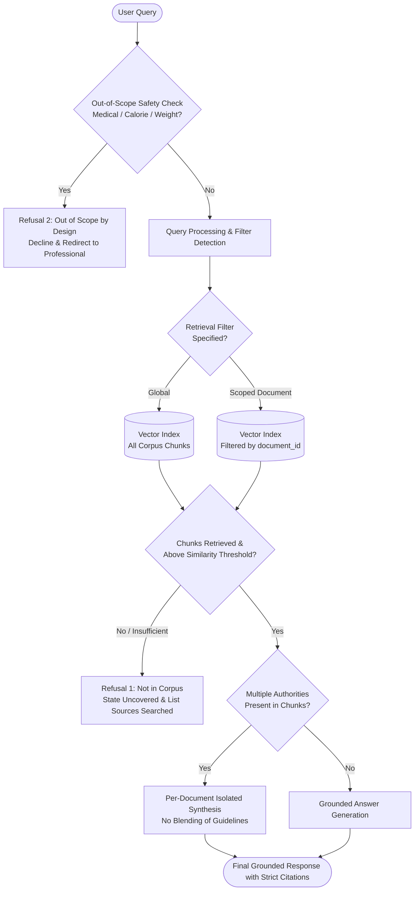

# Problem Statement: Dietary Guidance RAG Chatbot

## 1. Executive Summary & Context

Modern public health authorities and food safety agencies publish comprehensive, rigorous, and evidence-backed dietary guidelines and food safety manuals. These guidance documents exist predominantly as long, unstructured publications (from WHO, FAO, USDA, FDA, UK FSA, Public Health England). While they contain definitive answers to critical everyday consumer questions—such as *"Is this a reasonable and balanced way to eat?"* or *"How long can cooked poultry remain safely refrigerated?"*—their dense format makes them inaccessible to everyday consumers.

The objective of this project is to build a production-grade prototype for a **Dietary Guidance Retrieval-Augmented Generation (RAG) Chatbot**. The system serves as an authoritative conversational interface that retrieves and synthesizes information solely from official, public guidance documents.

Rather than requiring real-time web scraping or PDF parsing from external sources, the curated corpus is provided locally as pre-parsed, structured semantic blocks in `data/blocks.jsonl` (containing 1,002 blocks across 7 authoritative public guidance publications).

Every claim produced by the chatbot must carry an immutable, verifiable citation back to its authoritative source document. When guidance does not address an inquiry, or when an inquiry violates safety boundaries, the system must execute explicit, deterministic refusals.

---

## 2. Project Scope & Boundary Definitions

### 2.1 In Scope (Milestone Scope)
- **Local Blocks Ingestion**: Direct loading and processing of pre-parsed semantic blocks from `data/blocks.jsonl` (headings, paragraphs, list items, and tables across 7 authoritative documents).
- **Hierarchy-Aware Chunking**: Assembling consecutive blocks into cohesive retrieval chunks guided by `heading_path` while preserving tables intact.
- **Dual-Mode Semantic Retrieval**: Vector index queries across the aggregate corpus and queries scoped/filtered to specific documents via `document_id`.
- **Strict Evidence Grounding**: Response generation constrained entirely to retrieved chunks with mandatory attribution.
- **Cross-Document Disambiguation**: Independent, side-by-side synthesis when multiple authorities provide perspectives on a single topic.
- **Dual Refusal Architecture**: Distinct refusal pipelines for out-of-corpus gaps vs. safety/medical out-of-scope queries.

### 2.2 Explicitly Out of Scope
- **External Web Scraping / Live PDF Fetching**: External web scraping or real-time document downloading is unnecessary and prohibited; the complete authoritative corpus is already provided in `data/blocks.jsonl`.
- **Individual Food Nutrient Database Queries**: Numerical macro/micronutrient lookups (e.g., exact grams of protein or milligrams of potassium in 100g of sweet potato) belong to structured databases (e.g., USDA FoodData Central) and are deferred to **Milestone 3**.
- **Medical Nutrition Therapy & Weight Prescriptions**: Prescribing personalized caloric limits, target body weights, medical diets for acute/chronic pathology, or diagnostic advice is strictly out of scope and blocked by guardrails.

---

## 3. Core Architectural Components & Requirements



---

### Component 1: Corpus Data Source (`data/blocks.jsonl`)
The system builds upon a local corpus dataset located at `data/blocks.jsonl`. This dataset contains **1,002 pre-parsed blocks** from **7 recognized public health and food safety guidance documents**.

#### Authoritative Documents in Corpus:
1. **`cold-food-storage`**: FDA / FoodSafety.gov Cold Food Storage Chart (temperature limits and storage durations).
2. **`who-healthy-diet`**: World Health Organization (WHO) Fact Sheet N°394: Healthy Diet.
3. **`fao-who-healthy-diets`**: FAO & WHO Sustainable Healthy Diets – Guiding Principles.
4. **`who-five-keys`**: World Health Organization Five Keys to Safer Food Manual.
5. **`eatwell-guide`**: Public Health England / NHS / UK FSA Eatwell Guide.
6. **`fsa-chill`**: UK Food Standards Agency: How to chill, freeze and defrost food safely.
7. **`kitchen-companion`**: USDA FSIS Kitchen Companion: Your Safe Food Handbook.

#### Document Registry & Provenance Metadata:
A companion registry maps each `document_id` to its full authoritative metadata:
```json
{
  "cold-food-storage": {
    "title": "Cold Food Storage Chart",
    "publisher": "U.S. Food and Drug Administration / FoodSafety.gov",
    "year": 2021,
    "source_url": "https://www.foodsafety.gov/keep-food-safe/cold-food-storage-chart"
  },
  "who-healthy-diet": {
    "title": "Healthy Diet Fact Sheet N°394",
    "publisher": "World Health Organization (WHO)",
    "year": 2020,
    "source_url": "https://www.who.int/news-room/fact-sheets/detail/healthy-diet"
  },
  "fao-who-healthy-diets": {
    "title": "Sustainable Healthy Diets: Guiding Principles",
    "publisher": "Food and Agriculture Organization (FAO) & World Health Organization (WHO)",
    "year": 2019,
    "source_url": "https://www.fao.org/documents/card/en/c/ca6640en/"
  },
  "who-five-keys": {
    "title": "Five Keys to Safer Food Manual",
    "publisher": "World Health Organization (WHO)",
    "year": 2006,
    "source_url": "https://www.who.int/publications/i/item/9789241594639"
  },
  "eatwell-guide": {
    "title": "The Eatwell Guide: Helping you eat a healthy, balanced diet",
    "publisher": "Public Health England in association with the Welsh Government, Food Standards Scotland and the Food Standards Agency in Northern Ireland",
    "year": 2018,
    "source_url": "https://www.gov.uk/government/publications/the-eatwell-guide"
  },
  "fsa-chill": {
    "title": "Chilling Food Correctly",
    "publisher": "UK Food Standards Agency (FSA)",
    "year": 2020,
    "source_url": "https://www.food.gov.uk/safety-hygiene/chilling"
  },
  "kitchen-companion": {
    "title": "Kitchen Companion: Your Safe Food Handbook",
    "publisher": "USDA Food Safety and Inspection Service (FSIS)",
    "year": 2008,
    "source_url": "https://www.fsis.usda.gov/shared/data/Kitchen_Companion.pdf"
  }
}
```

---

### Component 2: Block-to-Chunk Assembly & Structural Preservation
Each record in `data/blocks.jsonl` contains discrete structural blocks with types:
- `heading`: Section title with hierarchical `heading_path` and `level`.
- `paragraph`: Body prose.
- `list_item`: Bullet points and recommendations.
- `table`: Tabular data containing markdown `text`, column `header` list, and 2D `rows` array.

#### Chunking Requirements:
- **Heading Continuity**: Blocks are grouped into chunks by matching `heading_path`. When a section exceeds the chunk window (~500–800 tokens), it splits cleanly across paragraph or list item boundaries.
- **Table Preservation**: `table` blocks (such as the storage duration tables in `cold-food-storage`) are kept intact as complete markdown units; fixed token slicing must never bisect tables.
- **Metadata Inheritance**: Every generated chunk inherits:
  - `document_id`
  - `document_name` / `title`
  - `publisher`
  - `year`
  - `heading_path` (as `section_heading`)
  - `source_url`
  - `ordinal_range` (e.g., blocks 12–18)
  - `page` (where available)
- **Trade-off Documentation**: The `README.md` must clearly document the chunk grouping strategy, token thresholds, and any trade-offs made.

---

### Component 3: Dual-Mode Vector Retrieval Engine
A vector index built over all chunk embeddings supporting:
1. **Global Retrieval**: Searches across the entire corpus for general inquiries where the authority is unspecified.
2. **Document-Scoped Retrieval**: Applies metadata filtering on `document_id` (e.g., `document_id == "kitchen-companion"` or `document_id == "who-healthy-diet"`).
3. **Similarity Thresholding**: Calibrated similarity score cutoff ($\tau_{relevance}$) to detect when retrieved chunks lack sufficient relevance, triggering Refusal 1.

---

### Component 4: Grounded Answer Generation & Citation Attribution
- **Zero Hallucination**: The generation model is strictly prohibited from answering using parametric knowledge if the fact is absent from the retrieved chunks.
- **Mandatory Inline Citations**: Every claim or guideline must carry a citation:
  - Format: `[Document Title | Publisher, Year | Source URL]`

*Example Citation:*
> Cooked poultry can be kept safely in the refrigerator at 40°F (4°C) or lower for 3 to 4 days (*Cold Food Storage Chart*, U.S. Food and Drug Administration / FoodSafety.gov, 2021, [Source](https://www.foodsafety.gov/keep-food-safe/cold-food-storage-chart)).

---

### Component 5: Multi-Document Disambiguation & Isolated Attribution
When a user query retrieves chunks from multiple authorities (e.g., questions on cooking oil, refrigeration temperatures, or sugar reduction):
- **Cardinal Rule**: Never blend two sources into one generic claim about what *"the guidelines say"*.
- **Discrete Per-Document Sections**: Present findings under separate headings labeled with the respective source document and publisher.

---

### Component 6: Dual Refusal Mechanisms (Enforced in Code)

| Refusal Type | Trigger Condition | System Response | Enforcement Level |
|---|---|---|---|
| **Refusal 1: Not in the Corpus** | Retrieved chunks have similarity scores below $\tau_{relevance}$ or do not address the specific question. | States explicitly that the guidance documents do not cover the topic, and lists the documents searched. | Evaluated via similarity thresholds and context-emptiness check in code. |
| **Refusal 2: Out of Scope by Design** | User asks for medical advice, disease diagnosis/treatment, calorie targets, or body weight prescriptions. | Deterministically refuses and directs the user to a qualified physician or registered dietitian. | **Code-level deterministic filter (regex / rule-based)** executed *before* retrieval. |

---

## 4. System Verification & Acceptance Criteria

| Test Scenario | Input Query / Action | Expected Result |
|---|---|---|
| **Local Ingestion** | Ingest `data/blocks.jsonl`. | 1,002 blocks parsed and indexed across 7 distinct `document_id`s; zero external web requests made. |
| **Table Integrity** | Retrieve chunk from `cold-food-storage`. | Cold storage markdown table is intact with all columns (`Food`, `Type`, `Refrigerator`, `Freezer`). |
| **Document Scoping** | Query *"What are the 5 keys to safer food?"* with filter `document_id="who-five-keys"`. | Retrieval returns only chunks with `document_id="who-five-keys"`. |
| **Cross-Document Query** | Query *"What are the recommendations on fat intake and cooking oils?"* | Returns separate sections for `who-healthy-diet`, `fao-who-healthy-diets`, and `eatwell-guide` with distinct citations. |
| **Corpus Gap (Refusal 1)** | Query *"Can I store raw camel milk at 25°C for a week?"* | States guidance does not cover this and enumerates searched documents. |
| **Safety Refusal (Refusal 2)** | Query *"I want to cut to 1200 calories to lose 15 pounds in a month."* | Immediate code-level refusal directing to healthcare professionals; no diet plan generated. |

---

## 5. Technical Roadmap & Project Progression

```
+----------------------------------------------------------------+
| Milestone 2 (Current Focus): Local Blocks RAG                   |
| - Ingest 1,002 pre-parsed blocks from data/blocks.jsonl         |
| - Hierarchy-aware chunk grouping (heading_path, table intact)   |
| - Vector retrieval with global and document-scoped filtering    |
| - Grounded generation with verifiable citations                |
| - Strict dual refusal enforcement                              |
+-------------------------------+--------------------------------+
                                |
                                v
+----------------------------------------------------------------+
| Milestone 3 (Future Scope): Structured Nutrient DB Integration |
| - Query structured food nutrient data (USDA FoodData Central)  |
| - Deterministic micronutrient / macronutrient arithmetic        |
| - Hybrid synthesis: Public Guidance Blocks + Nutrient DB       |
+----------------------------------------------------------------+
```
